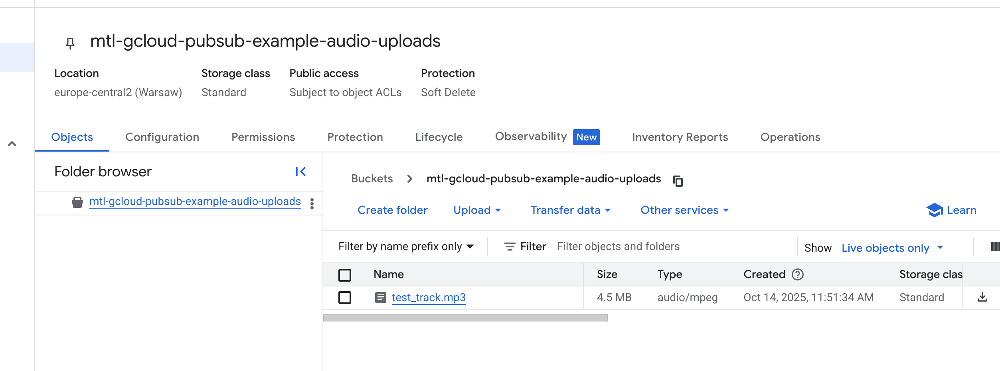
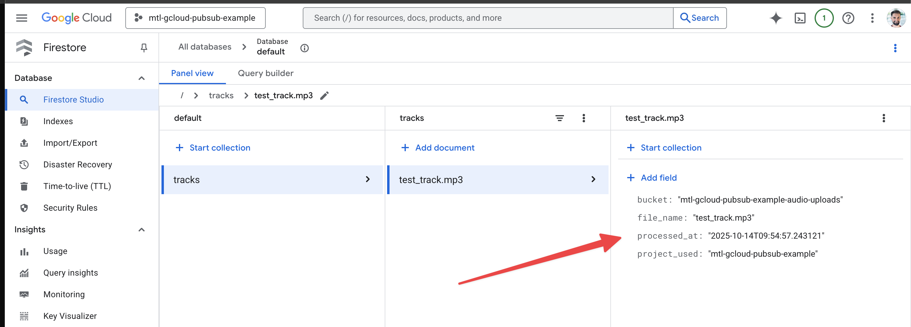

# 🎧 Sample Audio Worker with Cloud Run + Pub/Sub + Firestore Example

This project demonstrates a **minimal event-driven pipeline** for analyzing audio files in Google Cloud.  
When a file is uploaded to a Google Cloud Storage bucket, an event is sent via **Pub/Sub** to a **Cloud Run service**.  
That service then processes metadata and stores it in **Firestore** for further use (e.g., fingerprinting, BPM detection, etc.).

---

## 🧩 1. Architecture Overview

```text
[Client / System] → [GCS Bucket]
          │
          ▼
   GCS Notification → Pub/Sub Topic `audio.ingest`
          │
          ▼
 [Cloud Run Service: audio-worker]
          │
          ▼
 [Firestore: tracks/{file_id}]
```

---

## 🧱 2. Components

| Component | Description |
|------------|-------------|
| **Cloud Storage (GCS)** | Stores uploaded audio files. Triggers Pub/Sub events. |
| **Pub/Sub** | Messaging bus for asynchronous event delivery. |
| **Cloud Run** | Stateless container service that receives Pub/Sub push messages and processes them. |
| **Firestore** | NoSQL database that stores metadata about processed audio files. |

## ☁️ 3. Google Cloud Setup

### 🔹 Set active project

```bash
gcloud config set project mtl-gcloud-pubsub-example
```

### 🔹 Enable required APIs

```bash
gcloud services enable run.googleapis.com   artifactregistry.googleapis.com   cloudbuild.googleapis.com   pubsub.googleapis.com   firestore.googleapis.com   storage.googleapis.com
```

---

## 🧰 4. Build & Deploy

### Create Artifact Registry

```bash
gcloud artifacts repositories create mtl-repo   --repository-format=docker   --location=europe-central2   --description="Sample Audio Worker with Cloud Run + Pub/Sub + Firestore Example"
```

### Build image and push to Artifact Registry

```bash
gcloud builds submit   --tag europe-central2-docker.pkg.dev/mtl-gcloud-pubsub-example/mtl-repo/audio-worker
```

### Deploy to Cloud Run

```bash
gcloud run deploy audio-worker   --image europe-central2-docker.pkg.dev/mtl-gcloud-pubsub-example/mtl-repo/audio-worker   --platform managed   --region europe-central2   --allow-unauthenticated
```

After deployment, note the URL:

```text
https://audio-worker-xyz-uc.a.run.app
```

This is your **Pub/Sub push endpoint** → append `/pubsub` to it.

---

## 🔔 5. Pub/Sub Setup

### 5.1 Create a topic

```bash
gcloud pubsub topics create audio.ingest
```

### 5.2 Create a push subscription

```bash
gcloud pubsub subscriptions create audio.ingest-sub   --topic=audio.ingest   --push-endpoint=https://audio-worker-307014563925.europe-central2.run.app/pubsub   --push-auth-service-account=$(gcloud projects describe mtl-gcloud-pubsub-example --format='value(projectNumber)')-compute@developer.gserviceaccount.com
```

---

## 🧪 6. Test the Pipeline

### 6.1 Create Cloud Storage Bucket

```bash
gsutil mb -l europe-central2 gs://mtl-gcloud-pubsub-example-audio-uploads
```

### 6.2 Grant viewer role

```bash
gcloud projects add-iam-policy-binding mtl-gcloud-pubsub-example \
  --member="serviceAccount:$(gcloud projects describe mtl-gcloud-pubsub-example --format='value(projectNumber)')-compute@developer.gserviceaccount.com" \
  --role="roles/storage.objectViewer"
```

### 6.3 Upload test track
```bash
gsutil cp demo/test_track.mp3 gs://mtl-gcloud-pubsub-example-audio-uploads/
```


### 6.4 Publish a test message

```bash
gcloud pubsub topics publish audio.ingest  --message='{"bucket":"mtl-gcloud-pubsub-example-audio-uploads","name":"test_track.mp3"}'
```

### 6.5 Check logs

```bash
gcloud run services logs read audio-worker --region=europe-central2
```

Expected output:

```text
📦 Processing file: gs://mtl-gcloud-pubsub-example-audio-uploads/test_track.mp3
✅ Saved metadata to Firestore.
```

### 6.6 Verify in Firestore

Go to:  
👉 [Firestore Console](https://console.cloud.google.com/firestore/databases/default/data/panel?project=mtl-gcloud-pubsub-example)

You should see a document under:

```text
tracks / test_track.mp3
```

### 6.7 Screenshots





---

## ⚙️ 7. (Optional) Trigger from GCS Uploads

To automatically trigger Pub/Sub events when a file is uploaded:

```bash
gsutil notification create -t audio.ingest -f json gs://mtl-gcloud-pubsub-example-audio-uploads
```

Now every upload (`OBJECT_FINALIZE`) will trigger the audio-worker pipeline automatically.

---

## 🧠 8. Next Steps

You can extend this base pipeline by adding:

- 🎵 **Audio analysis** (e.g., fingerprinting, BPM, duration)
- 🔁 **Additional Pub/Sub stages** (`audio.processed`, `audio.failed`)
- 💾 **Metadata enrichment** (read tags, artist, ISRC, etc.)
- 📊 **Dashboard** reading Firestore data in Streamlit or BigQuery

---

## 📜 9. License

MIT License — see [LICENSE](LICENSE) for details.

---

<div align="center">
  MusicTech Lab - Rockstars Developers dedicated to the Music Industry<br>
  <a href="https://musictechlab.io">Website</a>
  <span> | </span>
  <a href="https://linkedin.com/company/musictechlab">LinkedIn</a>
  <span> | </span>
  <a href="https://musictechlab.io/contact">Let's talk</a><br>
  Crafted by <a href="https://musictechlab.io">musictechlab.io</a>
</div>
